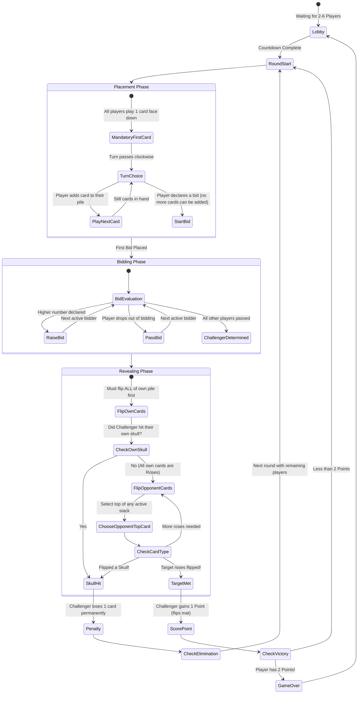
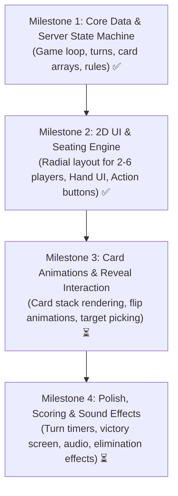

# Skulls & Roses (Roblox) — Complete AI Developer Handover Document

**Document Version:** 1.0 (Stable Base Game Release)  
**Target Engine:** Roblox (Luau `--!strict`)  
**Sync Tool:** Rojo 7.7.1  
**Repository:** [https://github.com/Goviid/RobloxProject](https://github.com/Goviid/RobloxProject)  
**Base Release Tag:** `v1.0-base-game` | **Branch:** `main` (Backup: `base-game-backup`)  
**Compiled Place File:** `F:\RobloxProject\RobloxProject.rbxlx`

---

## 1. Overview

### 1.1 What the Game Is
**Skulls & Roses** is a multiplayer 2D/2.5D tabletop bluffing game for Roblox, directly adapted from the world-renowned tabletop card/coaster bluffing game *Skull & Roses* (designed by Hervé Marly). The game is visually and structurally styled after high-end Roblox tabletop experiences (such as LOCOfficial) blended with a **Theme A: Calavera / Day of the Dead** aesthetic (deep dark-wood poker table, gold filigree trim, neon cyan/amber accents, crimson rose tokens, and obsidian skull tokens).

### 1.2 Core Gameplay Loop
The standard game is played with **4 players** (1 human player at **Seat 1**, and 3 AI bots at **Seats 2 to 4**: `BLUFFER_99`, `BLUFFE_99`, and `ROSE_KING`). The architecture natively supports dynamic radial seating for **2 to 6 players**.

1. **Setup**: Each player begins with a hand of **4 cards** (3 **Roses**, 1 **Skull**) and 0 points.
2. **Placement Phase**:
   - Starting player (Round Leader) and each subsequent player in strict clockwise seat order must place 1 card face-down on their table coaster (**Mandatory 1st Card**).
   - Once all active players have placed their 1st card, players may choose on their turn to either:
     - **Place another card** face-down onto their personal stack.
     - **Start a Bid** (declare how many roses they can flip across all table stacks without hitting a single skull).
3. **Bidding Phase**:
   - Once the first bid is placed, no further cards can be played for the remainder of the round.
   - In clockwise turn order, each active bidder must either **Raise the Bid** (minimum +1, up to total cards on the table) or **Pass**.
   - If a player bids the maximum possible number of cards on the table, bidding ends instantly.
   - When all other players have passed, the highest bidder becomes the **Challenger**.
4. **Revealing Phase**:
   - **Crucial Rule**: The Challenger **must flip ALL cards in their own stack first**, starting from the top down.
   - If the Challenger survives their own stack (all roses), they may choose any opponent's stack and peel cards one by one from the top.
   - If the Challenger flips the target number of **Roses**, they score **1 Point**.
   - If the Challenger flips a **Skull** (either their own or an opponent's):
     - The challenge immediately fails.
     - The Challenger permanently loses **1 card** (destroyed from their hand/stack).
     - If the Challenger has 0 cards remaining, they are **Eliminated**.
5. **Round Scoring & Victory**:
   - First player to reach **2 Points** (`Constants.POINTS_TO_WIN = 2`) wins the match.
   - If a player scored, they start the next round as Round Leader.
   - If the Challenger hit an opponent's skull, that opponent starts the next round.
   - If the Challenger hit their own skull, the Challenger starts the next round (if not eliminated).
   - A player who loses their last card is eliminated; the last player with cards left wins the match.

### 1.3 Target Audience
Fans of competitive tabletop games, bluffing games, social deduction (Liar's Dice, Coup, Sheriff of Nottingham), and modern digital card games (Uno, Hearthstone, Exploding Kittens) looking for fast-paced, high-stakes psychological bluffing matches on PC, mobile, and console.

---

## 2. Project Structure

```
F:\RobloxProject/
├── .gitignore               # Ignores .rbxl, .rbxlx, locks, sourcemaps, temp files
├── default.project.json      # Rojo 7.7.1 mapping configuration
├── IMPLEMENTATION_PLAN.md   # Core design specification, rules, and milestones
├── CODE_GUIDE.md             # File-by-file code reference
├── README.md                 # Setup and getting started instructions
├── RobloxProject.rbxlx      # Compiled place file ready to open directly in Roblox Studio
├── HANDOVER.md               # This handover document
└── src/
    ├── shared/               # Code replicated to both Server and Client (ReplicatedStorage.Shared)
    │   ├── Constants.luau    # Global game constants, timers, player thresholds, seat math
    │   ├── Enums.luau        # GameState, CardType, PlayerAction, TurnType, ArenaMode
    │   └── Network.luau      # RemoteEvent and RemoteFunction instantiation & accessors
    ├── server/               # Server-authoritative logic (ServerScriptService.Server)
    │   ├── init.server.luau  # Server lifecycle, player join/leave, bot spawner, chat commands
    │   ├── PlayerManager.luau# Secret hand storage, stack tracking, seat order, data sanitization
    │   ├── RoundManager.luau # Match referee, turn transitions, action guards, rule enforcement
    │   ├── BotController.luau# AI bluffing, placement, bidding, and card revealing heuristics
    │   ├── TableBuilder.luau # 3D parlor table, chairs, floor, neon trims, bot dummy avatars
    │   └── Card3DManager.luau# Physical 3D cylinder cards on table, ClickDetectors, reveal tweens
    └── client/               # Local player scripts (StarterPlayer.StarterPlayerScripts.Client)
        ├── init.client.luau  # Client bootstrapper, ScreenGui coordinator, network listeners
        ├── CameraController.luau # Fixed 2.5D overhead tabletop camera & local avatar hiding
        ├── AudioController.luau  # Sound effect playback with pitch variation & fallbacks
        └── UI/               # Modular 2D screen interfaces
            ├── Theme.luau             # Day of the Dead color tokens, fonts, styles
            ├── TableView.luau         # Top arcade 3-pill HUD & real-time turn countdown
            ├── HandBar.luau           # Floating circular card fan docked at bottom screen
            ├── ActionBar.luau         # Bottom-right [BID], [RAISE BID], [PASS] pills & Bid Modal
            ├── NotificationBanner.luau# Top announcement toasts & 15s depleting timer bar
            ├── CardRevealModal.luau   # Center dramatic card flip popup (Rose vs Skull)
            ├── CardAnimation.luau     # Flying card physics tween module
            └── VictoryModal.luau      # Fullscreen match victory popup celebrating winner
```

### Rojo vs Place File
- **Primary Development Environment:** The project is configured with **Rojo 7.7.1** via `default.project.json`. Files inside `src/` are edited directly in an external editor / IDE and live-synced into Roblox Studio.
- **Compiled Place File:** `RobloxProject.rbxlx` is a compiled XML Roblox place file generated using `rojo build -o "RobloxProject.rbxlx"`. It can be opened directly in Roblox Studio without Rojo, but running `rojo serve` is recommended for active development.

---

## 3. Services and Architecture

### 3.1 Mapping of Code to Roblox Services

| Filesystem Path | Roblox Service Destination | Description |
| :--- | :--- | :--- |
| `src/shared/` | `ReplicatedStorage.Shared` | Modules required by both server and client |
| `src/server/` | `ServerScriptService.Server` | Server-authoritative logic, state machine, 3D managers |
| `src/client/` | `StarterPlayer.StarterPlayerScripts.Client` | Local controllers, UI managers, camera locks |
| Generated in runtime | `Workspace.SkullsArena` | 3D table, parlor floor, chairs, and bot dummy models |
| Generated in runtime | `Workspace.SkullsArena.TableCardStacks` | 3D physical cylinder cards with `ClickDetector` |
| Generated in runtime | `ReplicatedStorage.SkullsNetwork` | Folder holding all `RemoteEvent` and `RemoteFunction` instances |
| Generated in runtime | `SoundService.SkullsAudioFolder` | Folder holding pre-configured `Sound` instances |

### 3.2 Networking Architecture (`ReplicatedStorage.SkullsNetwork`)

All remote instances are lazily retrieved or constructed by `src/shared/Network.luau`:

#### Client -> Server Invocation
- **`SubmitAction` (`RemoteFunction`)**:
  - Signature: `(player: Player, action: string, data: any) -> (boolean, string?)`
  - Validated by `RoundManager.HandlePlayerAction(userId, action, data)`.
  - Actions:
    - `"PlaceCard"`: `{ cardType: "Rose" | "Skull" }`
    - `"StartBid"`: `{ bid: number }`
    - `"RaiseBid"`: `{ bid: number }`
    - `"Pass"`: `{}`
    - `"RevealCard"`: `{ targetUserId: number }`

#### Client -> Server Events
- **`RequestState` (`RemoteEvent`)**:
  - Signature: `(player: Player)`
  - Fired by client upon startup, respawn, or action rejection to guarantee UI is in sync with server state.

#### Server -> Client Events
- **`GameStateChanged` (`RemoteEvent`)**:
  - Broadcasts sanitized state payload to players (`gameState`, `roundNumber`, `activePlayerId`, `challengerId`, `highestBid`, `highestBidderId`, `cardsFlipped`, `targetCards`, `totalCardsOnTable`, `canStartBid`, `tableState`).
- **`CardPlayed` (`RemoteEvent`)**:
  - Signature: `(userId: number, stackCount: number)`
- **`BidUpdated` (`RemoteEvent`)**:
  - Signature: `(bidderId: number, highestBid: number)`
- **`CardRevealed` (`RemoteEvent`)**:
  - Signature: `(data: { targetUserId: number, cardType: string, stackRemaining: number, cardsFlipped: number, targetCards: number })`
- **`Notification` (`RemoteEvent`)**:
  - Signature: `(data: { text: string, style: string })` (`style`: `"info" | "warning" | "success" | "alert"`)
- **`PlayerEliminated` (`RemoteEvent`)**:
  - Signature: `(userId: number)`
- **`GameOver` (`RemoteEvent`)**:
  - Signature: `(winnerId: number)`

### 3.3 Security & Anti-Cheat Model
- **Strict Server Authoritative Hand Storage**: In `PlayerManager.luau`, each player's `hand` array and `playedStack` array are kept in private server memory.
- **Sanitized Replication**: `PlayerManager.GetClientState(forUserId)` creates a sanitized table where:
  - The calling player (`forUserId`) receives their own true hand (`{ "Rose", "Rose", "Skull" }`).
  - Opponent hands are stripped (`nil`).
  - All opponent played cards are hidden; clients only receive `stackCount` (the number of cards stacked on their coaster).
  - Exploiting clients cannot inspect memory to read opponents' face-down cards.

---

## 4. Systems Implemented

### 4.1 Player State & Hand Management (`src/server/PlayerManager.luau`)
- **Status:** **COMPLETE**
- **How it works:**
  - Manages player table `players[userId] = PlayerData`.
  - Automatically allocates seats 1 to 6. Reserves **Seat 1** for the human player and **Seats 2-4** for bots.
  - Hands default to 3 Roses + 1 Skull (`createDefaultHand()`). Hand sorting keeps Roses on the left and Skulls on the right.
  - `PlayCard`: Removes card from `p.hand` and pushes to `p.playedStack`.
  - `DestroyCard`: Permanently discards a card when a skull is revealed. If total cards reach 0, sets `p.isEliminated = true`.
  - `ResetRoundState`: Returns unrevealed played stack cards and revealed cards back to player hands at round conclusion.

### 4.2 State Machine & Referee (`src/server/RoundManager.luau`)
- **Status:** **COMPLETE**
- **How it works:**
  - Enforces all phases: `Lobby` -> `Placement` -> `Bidding` -> `Revealing` -> `RoundEnd` -> `MatchEnd`.
  - **Turn Serialization (`turnLock`)**: Mutex guard in `HandlePlayerAction` rejects concurrent/overlapping client invokes and sends a clean state resync if rejected.
  - **Thread Tracking (`turnTimerThread`, `botTurnThread`)**: Tracks running coroutines and cancels them inside `cancelTurnTimer()` so orphan timer or bot threads never fire out-of-turn.
  - **Clockwise Seat Progression (`advanceToNextActivePlayer(skipPassed)`)**: Advances strictly in ascending seat order (`1 -> 2 -> 3 -> 4 -> 1`), cleanly skipping eliminated players and passed bidders.
  - **Skull Penalty & Leadership Transfer**:
    - Challenger hit own skull: Challenger loses 1 card; challenger starts next round if not eliminated.
    - Challenger hit opponent's skull: Challenger loses 1 card; skull owner starts next round.

### 4.3 AI Bot Decision Engine (`src/server/BotController.luau`)
- **Status:** **COMPLETE**
- **How it works:**
  - `DecidePlacementAction`:
    - Requires `#p.playedStack >= 2 and totalCardsOnTable >= 5` before considering opening a bid (prevents bots from immediately hijacking Turn 2 before players place second cards).
    - Plays 75% Rose, 25% Skull (bluff).
    - Guarantees non-nil fallback actions so bot turns never stall.
  - `DecideBiddingAction`:
    - Evaluates safe bid thresholds based on own placed roses and table cards. Passes if current bid exceeds confidence.
  - `DecideCardToReveal`:
    - Strictly flips own pile first.
    - Once own pile is clear, picks a random active opponent stack.

### 4.4 3D Table Parlor & Avatar Environment (`src/server/TableBuilder.luau`)
- **Status:** **COMPLETE**
- **How it works:**
  - Procedurally creates the `Workspace.SkullsArena` model.
  - Builds the circular dark-wood poker table with burgundy felt, beveled leather armrests, individual player pile mats with neon borders, and dark armchairs.
  - Builds standing R6/R15 blocky bot dummy avatars at Seats 2-4 with overhead billboard nametags and animated speech bubble emotes (`SetBotEmote(seatIndex, emote)`).
  - Positions the human player cleanly at Seat 1 with an anchored spawn pad.
  - Supports runtime environment switching via chat commands: `/void` (minimalist light-blue void) and `/table` (classic dark parlor).

### 4.5 3D Physical Table Cards (`src/server/Card3DManager.luau`)
- **Status:** **COMPLETE**
- **How it works:**
  - Spawns physical 2.2-stud cylinder parts on the table in front of each seat coaster.
  - Stacks cards vertically with concentric alignment (`stackY = baseY + 0.03 + (stackCount - 1) * 0.06`).
  - Top face contains a `SurfaceGui` displaying a concentric gold border and medallion emblem (`✦`).
  - `ClickDetector` on cards and coasters: Only active during the `Revealing` phase (`SetRevealingEnabled(true)`), allowing the challenger to click directly on 3D table stacks to flip them.
  - `RevealCard3D`: Card lifts +1.2 studs, rotates 180° with `Enum.EasingStyle.Back`, turns red/charcoal displaying `🌹` or `💀`, then settles flat onto the table.
  - `ClearAllCards`: Shrinks and destroys all table parts at round end.

### 4.6 Camera Controller (`src/client/CameraController.luau`)
- **Status:** **COMPLETE**
- **How it works:**
  - Overrides default Roblox camera with a fixed 2.5D overhead perspective (`lookTarget = Vector3.new(0, 3.0, 0.5)`, `camPos = Vector3.new(0, 9.6, 9.8)`).
  - Locks camera at `Enum.RenderPriority.Last.Value` to prevent Roblox engine scripts from wresting control.
  - Binds to `ContextActionService` with high priority to sink mouse panning and movement inputs.
  - `HideLocalCharacter`: Runs on `RenderStepped` to set `Transparency = 1` and `LocalTransparencyModifier = 1` on all local player character parts, decals, and particle emitters. The player's avatar is completely invisible locally (never blocks the table view) while remaining fully visible to other players.
  - Features dynamic FOV turn punch on active turn and dramatic screen shake (`ShakeOnSkull()`) when a skull is revealed.

### 4.7 2D Client UI (`src/client/UI/`)
- **Theme (`Theme.luau`)**: **COMPLETE** — Calavera color palette, FredokaOne / GothamBold typography, dark surfaces, crimson velvet, gold filigree.
- **Top Arcade HUD (`TableView.luau`)**: **COMPLETE** — 3-pill header layout matching the arcade reference mockup:
  - Left Pill: Dynamic turn counter (`1 TURN`, `2 TURN`, or `BID: X` / `FLIPS: X/Y`).
  - Center Pill: `ROUND 1: PLACEMENT PHASE` with glowing amber border.
  - Right Pill: Dynamic turn indicator & timer (`👤 YOU (15s)` or `🤖 {NAME} (15s)`).
- **Floating Hand Fan (`HandBar.luau`)**: **COMPLETE** — Large circular tokens (120px) docked at the bottom of the screen with resting fan angles.
  - Left tokens = Cream Roses with gold rims; Right token = Dark Skull with neon crimson rim.
  - Hover elevation (-35px) with glow stroke expansion.
  - Direct placement on click during Placement phase.
  - Debounced mouse click with `isSubmitting` flag and `isPlayerTurn` check.
  - Smart DOM element caching in `UpdateHand` to prevent UI destruction/rebuild click drops when bot state broadcasts arrive.
- **Action Bar (`ActionBar.luau`)**: **COMPLETE** — Anchored strictly in the bottom-right corner:
  - `[ ⚡ BID ]` button during Placement phase (opens frosted glass Bid Stepper modal).
  - Side-by-side `[ ⚡ RAISE BID ]` and `[ ✕ PASS ]` pills during Bidding phase.
  - `[ 👁 FLIP STACK ]` pill during Revealing phase.
- **Notification Banner (`NotificationBanner.luau`)**: **COMPLETE** — Slide-down announcement pill with a 15-second depleting horizontal progress bar.
- **Card Reveal Modal (`CardRevealModal.luau`)**: **COMPLETE** — Dramatic center-screen card flip popup with front/back animation, owner name, and flips progress counter.
- **Chat Box**: *Removed (UI step 2, 2026-11-16)*. Roblox's built-in chat is used; game events show as pop-ups (`Toast.luau`) and match status in `StatusBar.luau`, which replaced `TableView.luau` and `NotificationBanner.luau`.
- **Victory Modal (`VictoryModal.luau`)**: **COMPLETE** — Match end popup celebrating the 2-point winner with crown icon and countdown to the next match.
- **Flying Card Physics (`CardAnimation.luau`)**: **PARTIAL** — Module exists with elastic trajectory math, but direct 3D placement tweens in `Card3DManager.luau` are currently preferred.

### 4.8 Audio Controller (`src/client/AudioController.luau`)
- **Status:** **COMPLETE**
- **How it works:**
  - Manages sound effects loaded into `SoundService.SkullsAudioFolder`.
  - Applies organic pitch randomization (0.94x to 1.06x) on card clicks and flips for a natural tabletop feel.

---

## 5. Data Persistence & External APIs

### 5.1 Player Data Storage
- **Current Implementation:** **In-Memory Session Only**.
- **DataStore Usage:** **None**. There is currently no `DataStoreService`, `MemoryStoreService`, or external database integrated into the project.
- **Session State:** Hand data, stacks, scores, and seat assignments are stored strictly in Luau memory in `src/server/PlayerManager.luau`.
- **Reset Behavior:** When all players leave, or when the server restarts, player stats reset to default.
- **External Services / APIs:** None. `HttpService` is not enabled or utilized.

---

## 6. Assets & Hardcoded Identifiers

### 6.1 Geometry & Models
All 3D models (the parlor room, table, felt surface, chairs, mats, cards, and bot dummy bodies) are **100% procedurally built** in `src/server/TableBuilder.luau` and `src/server/Card3DManager.luau` using standard Roblox primitive parts (`Part`, `Cylinder`, `SmoothPlastic`, `Neon`, `SurfaceGui`, `UICorner`, `UIStroke`). No external `.rbxm` mesh assets are required.

### 6.2 Audio Asset IDs (`src/client/AudioController.luau`)

Replaced 2026-11-16: the original IDs were mostly not audio at all (places, scripts, an image), so every game sound except the button click was silent. Each ID below was verified as an Audio asset with `MarketplaceService:GetProductInfo`.

| Sound | Asset ID | Source | When it plays |
| :--- | :--- | :--- | :--- |
| `CardPlace` | `9118833191` | Pro Sound Effects "Scrapbook Close 1" | Any player places a card |
| `CardFlip` | `3456145589` | "card_flip" by f4ngy (Freesound, Attribution licence: credit required) | A card is revealed |
| `RevealNote` | `9120433452` | "Violin String Pluck Single Notes 9" (Pro Sound Effects) | Revealed card is a Rose: one note, a step higher up a major scale per flip in the challenge |
| `SkullReveal` | `130018094603454` | Daily Sounds "Horror Stinger" | Revealed card is a Skull |
| `PointScored` | `1840076509` | APM "Through the Roof (sting)" | A challenge succeeds |
| `Victory` | `1836473422` | APM "Victory Fanfare Sting" | Match won |
| `ButtonClick` | `6895079853` | "UI Click" | UI buttons |
| `TimerTick` | `6895079853` | "UI Click", pitched down | Last 5 s of your turn; lobby countdown |
| `YourTurn` | `106984966606682` | Daily Sounds "Cartoon Pop" | Your turn starts |
| `Eliminated` | `96795857757261` | Daily Sounds "Power Down" | You lose your last card |
| `MatchStart` | `87058958593472` | Daily Sounds "Church Bell Toll" | Round 1 of a match |
| `ErrorBuzz` | `91501650514390` | Daily Sounds "Error Buzz" | The server rejects your action |
| `BurnSound` (server, `Card3DManager`) | `9117983605` | Pro Sound Effects "Pyro Fire Ball Burst 9" | A lost card burns on the table (positional, from that pile) |

---

## 7. Known Bugs, Workarounds, and TODOs

### 7.1 Solved Bugs & Workarounds in Place
1. **Skull Reveal Crash**:
   - *Issue*: `RoundManager.onChallengerFailed` previously called `TableBuilder.SetBotEmote`, which was missing and crashed the server thread before the next round was scheduled.
   - *Fix*: Implemented `TableBuilder.SetBotEmote` with overhead speech bubble UI and wrapped all emote triggers in `pcall`.
2. **Premature Bot Bidding**:
   - *Issue*: Bots bid immediately on their very first Turn 2 opportunity, preventing the human player from placing a second card.
   - *Fix*: Added `#p.playedStack >= 2 and totalCardsOnTable >= 5` condition in `BotController.DecidePlacementAction`.
3. **Turn Progression Desync / Lockouts**:
   - *Issue*: Rapid card clicking or overlapping bot coroutines desynchronized `activePlayerIndex`.
   - *Fix*: Added `turnLock` guard in `RoundManager.HandlePlayerAction`, added `botTurnThread` tracker that cancels existing threads in `cancelTurnTimer()`, and refactored `advanceToNextActivePlayer()` to strictly cycle through active seats.
4. **Card Token Disappearance & Click Drops**:
   - *Issue*: `HandBar.luau` ran an exit animation before verifying turn validity, and rebuilt the entire DOM on every `GameStateChanged` event.
   - *Fix*: Added `if not isPlayerTurn then return end` check, implemented `isSubmitting` debounce, switched to `MouseButton1Click`, and added element preservation in `UpdateHand`.
5. **Bot Name Lookup on Game Over**:
   - *Issue*: Winning bots displayed as `"Player -100"`.
   - *Fix*: Looked up `lastKnownPlayers[tostring(winnerId)].name` before falling back to `Players:GetPlayerByUserId`.

### 7.2 Known Limitations & TODOs
1. **Interactive Discard Choice for Skull Penalty**:
   - *Done (2026-11-15)*: Classic rules. A skull hit enters `GameState.Discarding`. Own skull → the challenger picks which of their cards to lose; someone else's skull → that player removes one of the challenger's cards blindly (`UI/DiscardModal.luau`, `BotController.DecideDiscard`). Timeout picks at random; a single remaining card is removed automatically.
2. **Persistent Progression / DataStore**:
   - *Current State*: Session-only in-memory data.
   - *TODO*: Implement `DataStoreService` to persist player wins, win streaks, games played, and unlockable custom card/coaster skins.
3. **Custom Calavera Texture Assets**:
   - *Current State*: 3D cards and 2D tokens use clean procedural shapes and unicode emoji (`🌹`, `💀`, `✦`).
   - *Done (2026-11-16)*: 8 Calavera card sets (back / skull / rose) uploaded and wired in via `src/shared/CardArt.luau`: hand, 3D table cards and hand tokens, reveal pop-up, card-loss picker, flying and burning cards. Each player gets a random unique set per match. *2026-11-19*: Obsidian Cyan parked (too close to Blue Diamond); Ivory and Magenta added, so 8 sets are still in play.
4. **Spectator Camera**:
   - *Current State*: Eliminated players remain seated at the table.
   - *TODO*: Add an overhead free-orbit spectator camera mode for players once eliminated.
5. **Lobby Matchmaking**:
   - *Current State*: Standalone place with auto-populated test bots for solo testing.
   - *TODO*: Add table-selection lobby pads or GUI server matchmaking to host multi-table games in a shared lobby.

---

## 8. Conventions & Standards

- **Language:** Luau with strict mode (`--!strict`) declared at the top of every file.
- **Naming Conventions:**
  - Files & Modules: `PascalCase` (`RoundManager.luau`, `Card3DManager.luau`).
  - Functions & Public Methods: `PascalCase` (`PlayerManager.AddPlayer()`, `RoundManager.StartRound()`).
  - Private Helpers & Variables: `camelCase` (`advanceToNextActivePlayer()`, `currentGameState`).
  - Constants: `SCREAMING_SNAKE_CASE` (`TURN_TIMEOUT`, `POINTS_TO_WIN`).
- **External Packages:** Zero external dependencies. No Wally, No Roact, No Fusion, No Knit. The codebase is 100% native Luau utilizing standard Roblox engine services.
- **Encoding:** All files MUST be saved as **UTF-8 with BOM or standard UTF-8** to preserve emoji characters (`🌹`, `💀`, `✦`, `👑`).

---

## 9. History of Major Decisions

1. **Why LOCOfficial-Inspired 2.5D Overhead Framing?**
   - Pure 3D first-person cameras make reading cards across a table awkward on mobile.
   - Pure 2D interfaces lack physical tabletop immersion.
   - Combining a locked overhead 2.5D camera (`CameraController.luau`) with physical 3D table stacks and floating 2D circular tokens provides the ideal balance of tactile gameplay and clean mobile/desktop touch controls.
2. **Why 3D Cylinder Cards on Table Coasters?**
   - Physical 3D stacks let players visually gauge how many cards opponents have committed at a glance without having to read UI text.
3. **Why Seat Order Turn Advancement?**
   - The game rules dictate strict clockwise play around a physical table. Seat indices (1 to 6) form the single source of truth for turn advancement.
4. **Why Server-Side Bot Execution?**
   - Bots run entirely on the server via `BotController.luau` and `RoundManager.checkBotTurn()`. This ensures matches run identically whether testing locally with bots or playing with live human players across the network.

---

## 10. Next Steps for the Next AI Developer

If you are continuing work on this project, prioritize these tasks in order:

1. **Interactive Discard Modal**:
   - Hook into `RoundManager.onChallengerFailed`.
   - If the player is human, fire a `RemoteEvent` (`SelectDiscardCard`) and wait for their choice via `SubmitAction("DiscardCard")` before falling back to random discard.
2. **Custom Decal Textures**:
   - Replace emoji text labels in `Card3DManager.luau` (`FaceGui`) and `HandBar.luau` (`TokenButton`) with custom uploaded ImageLabel asset IDs (`rbxassetid://...`).
3. **DataStore Integration**:
   - Create `src/server/DataManager.luau`.
   - Bind to `Players.PlayerAdded` and `Players.PlayerRemoving` with `pcall` data store wrappers to track lifetime wins and games played.
4. **Spectator Cycling**:
   - In `CameraController.luau`, add an arrow button UI for eliminated players to cycle the camera view between remaining active players.

---

## 11. Complete Project File Contents

Below are the exact contents of every markdown, configuration, and documentation file in the repository.

### 11.1 `F:\RobloxProject\README.md`
```markdown
# Skulls & Roses (Roblox)

A multiplayer 2D/2.5D tabletop bluffing game for 2 to 6 players on Roblox, inspired by *Skull & Roses* and styled with Theme A (Calavera / Day of the Dead).

---

## 📖 Project Documentation

* **[Implementation Plan (IMPLEMENTATION_PLAN.md)](IMPLEMENTATION_PLAN.md)** — Core rules, state machine flowcharts, UI layout wireframes, security model, and milestone roadmap.
* **[Code & Architecture Guide (CODE_GUIDE.md)](CODE_GUIDE.md)** — Plain-English walkthrough of every file, module, remote event, and game mechanic.

---

## 🛠️ Getting Started & Local Development

### 1. Build Place File
```bash
rojo build -o "RobloxProject.rbxlx"
```

### 2. Start Live Sync
```bash
rojo serve
```
Then open `RobloxProject.rbxlx` in Roblox Studio, navigate to the **Plugins** tab, and click **Connect** on Rojo.

---

## 📦 Project Structure

```
F:\RobloxProject/
├── IMPLEMENTATION_PLAN.md     # Full design and roadmap
├── CODE_GUIDE.md              # File-by-file code guide
├── default.project.json       # Rojo configuration
├── src/
│   ├── shared/                # Constants, Enums, Network
│   ├── server/                # PlayerManager, RoundManager, BotController, init
│   └── client/                # UI (Theme, HandBar, ActionBar, TableView, NotificationBanner)
```
```

### 11.2 `F:\RobloxProject\default.project.json`
```json
{
  "name": "RobloxProject",
  "tree": {
    "$className": "DataModel",

    "ReplicatedStorage": {
      "Shared": {
        "$path": "src/shared"
      }
    },

    "ServerScriptService": {
      "Server": {
        "$path": "src/server"
      }
    },

    "StarterPlayer": {
      "StarterPlayerScripts": {
        "Client": {
          "$path": "src/client"
        }
      }
    },

    "Workspace": {
      "$properties": {
        "FilteringEnabled": true
      },
      "Baseplate": {
        "$className": "Part",
        "$properties": {
          "Anchored": true,
          "CastShadow": false,
          "Transparency": 1,
          "CanCollide": false,
          "Locked": true,
          "Position": [
            0,
            -500,
            0
          ],
          "Size": [
            512,
            20,
            512
          ]
        }
      }
    },
    "Lighting": {
      "$properties": {
        "Ambient": [
          0.72,
          0.85,
          1.0
        ],
        "OutdoorAmbient": [
          0.68,
          0.83,
          0.98
        ],
        "Brightness": 1.6,
        "ClockTime": 14.0,
        "GlobalShadows": false,
        "Outlines": false,
        "Technology": "ShadowMap"
      }
    },
    "SoundService": {
      "$properties": {
        "RespectFilteringEnabled": true
      }
    }
  }
}
```

### 11.3 `F:\RobloxProject\.gitignore`
```gitignore
# Project place files (keep code in src/, places built with Rojo)
*.rbxlx
*.rbxl
*.rbxlx.lock
*.rbxl.lock

# Rojo sourcemap
sourcemap.json
.rojo/

# MCP / local auth
.robloxstudio-mcp/

# OS and temporary files
Thumbs.db
Desktop.ini
.DS_Store
*.tmp
```

### 11.4 `F:\RobloxProject\IMPLEMENTATION_PLAN.md`
```markdown
# Implementation Plan: Skull & Roses (Bluffing Game)

A multiplayer 2D/2.5D tabletop bluffing game for 2 to 6 players on Roblox, inspired by the classic card & coaster game *Skull & Roses* and styled with clean, responsive 2D interfaces (similar to modern Roblox card games like Uno).

---

## 1. Game Overview & Core Rules

Each player starts with **4 round cards** (3 **Roses**, 1 **Skull**) and a **Play Mat / Score Coaster**.

```
[Rose]  [Rose]  [Rose]  [Skull]
```

### Game Loop Flow



---

## 2. System Architecture & Project Structure

The project follows a **strict server-authoritative model** using Rojo and Luau to prevent exploiters from peeking at face-down cards.

### Directory Structure

```
F:\RobloxProject\
├── default.project.json
├── IMPLEMENTATION_PLAN.md          # This implementation plan
├── CODE_GUIDE.md                   # Plain-English file-by-file code reference
├── src/
│   ├── shared/
│   │   ├── Constants.luau          # Max/min players, timer lengths, card enums
│   │   ├── Enums.luau              # GameState, CardType, BidAction, PlayerState
│   │   └── Network.luau            # RemoteEvents & RemoteFunctions definitions
│   ├── server/
│   │   ├── init.server.luau        # Server entry point
│   │   ├── PlayerManager.luau      # Server-side player data (cards, scores, seats)
│   │   ├── BotController.luau      # AI bot decision engine
│   │   └── RoundManager.luau       # Placement, Bidding, Revealing logic
│   ├── client/
│   │   ├── init.client.luau        # Client bootstrapper
│   │   └── UI/
│   │       ├── Theme.luau          # Color palette & styling tokens
│   │       ├── NotificationBanner.luau # Announcements & 15s turn timer bar
│   │       ├── HandBar.luau        # Bottom 2D hand (3 Roses + 1 Skull)
│   │       ├── ActionBar.luau      # Contextual [Play Card], [Bid], [Pass]
│   │       └── TableView.luau      # Circular radial seat display (2-6 players)
```

---

## 3. 2D / Tabletop Visual Layout

Styled like modern digital tabletop games (UNO, Hearthstone, Exploding Kittens), combining a fixed overhead 2.5D camera with clean 2D screen UI.

```
+-------------------------------------------------------------------+
|  [Score: 1/2] Player 3               [Score: 0/2] Player 4        |
|     (Pile: 2 cards)                     (Pile: 3 cards)           |
|                                                                   |
|  [Score: 0/2] Player 2     [ CENTER TABLE ]     [Score: 0/2] P5   |
|     (Pile: 1 card)       Current Bid: 4 (P1)      (Pile: 2 cards) |
|                          Turn Timer: [== 12s ==]                  |
|                                                                   |
|  [Score: 0/2] Player 6               [Score: 1/2] (You - P1)      |
|     (Pile: 0 cards)                     (Your Pile: 2 cards)      |
+-------------------------------------------------------------------+
|  ACTIONS:  [ Place Card ]   [ Bid / Challenge (4+) ]   [ Pass ]   |
+-------------------------------------------------------------------+
|  YOUR HAND:                                                       |
|    [ (Rose) ]       [ (Rose) ]       [ (Rose) ]       [ (Skull) ] |
+-------------------------------------------------------------------+
```

### Key UI Components
1. **Player Seat Pods (2 to 6)**: Positioned radially around the center table. Displays:
   - Player Avatar / Name.
   - Stack of face-down card tokens (visually stacked height = number of cards played).
   - Score petals (2 slots, lighting up upon scoring).
   - Card count remaining in hand.
2. **Hand Display (Bottom)**: 
   - Draggable / clickable 2D cards with hover effects.
   - Grayed out when placing is no longer allowed (once bidding starts).
3. **Challenger Reveal Interaction**:
   - When revealing, opponent stacks highlight. The challenger clicks an opponent's stack to peel off the top card with a 3D/2D flip animation.

---

## 4. Security & Anti-Cheat (Crucial for Bluffing)

> [!IMPORTANT]
> Because Skull & Roses is 100% about bluffing and hidden information, **card types must NEVER be replicated to client machines** until they are revealed by the challenger.

* The server maintains `PlayerPiles[userId] = { CardType.Rose, CardType.Skull, CardType.Rose }`.
* The client only receives: `PlayerPileCounts[userId] = 3` and `HasPlayedCard = true`.
* When a card is flipped during the Reveal phase, the server broadcasts ONLY that single revealed card's type to all clients.

---

## 5. Required Assets & Styling

| Asset | Description | Format / Specs |
| :--- | :--- | :--- |
| **Rose Card Face** | Vibrant ornamental floral artwork (Day of the Dead / Calavera style). | 512x512 PNG, circular with transparent border |
| **Skull Card Face** | Stylized ornate skull with warning colors (gold/crimson/black). | 512x512 PNG, circular |
| **Card Back** | Symmetrical ornate pattern so orientation gives nothing away. | 512x512 PNG, circular |
| **Play Mat / Coaster**| Decorative radial coaster with 2 score gem slots. | 512x512 PNG |
| **Audio - Card Slide**| Crisp paper/cardboard placement sound. | Short SFX |
| **Audio - Card Flip** | Satisfying snap/flip sound. | Short SFX |
| **Audio - Skull Reveal**| Sudden dramatic gong/stinger. | Dramatic SFX |
| **Audio - Point Scored**| Celebratory chime. | Positive SFX |

---

## 6. Implementation Milestones



### Phase Breakdown
* **Phase 1: Foundation (Shared & Server State) — COMPLETED**
  - Define `Constants.luau`, `Enums.luau`, and `Network.luau`.
  - Build `PlayerManager.luau` and `RoundManager.luau` to handle turn order, bidding arithmetic, and card resolution.
* **Phase 2: Client Interface & Hand Controls — COMPLETED**
  - Implement dynamic radial seating (auto-arranging 2 to 6 players).
  - Implement bottom hand UI with card selection and play confirmation.
  - Implement bidding panel with dynamic min/max increments.
* **Phase 3: Reveal Sequence & Animations — IN PROGRESS**
  - Interactive stack clicking for the challenger.
  - Card flip animation with front/back sprite transition.
  - Card discard selection when a skull is hit.
* **Phase 4: Match Lifecycle & Polish**
  - Round transition overlays ("Player 1 Bid 3!", "Skull Hit!", "Round Won!").
  - Match end screen celebrating the 2-point winner.
  - SFX integration and visual polish.
```

### 11.5 `F:\RobloxProject\CODE_GUIDE.md`
```markdown
# Skulls & Roses — Complete Code & Architecture Guide

Welcome to the **Skulls & Roses** project codebase! This document breaks down the entire project structure file by file, explaining what each section does and how the pieces communicate.

---

## 🗺️ Project Architecture Overview

The game follows a **Server-Authoritative** model to prevent cheating in a game where bluffing and hidden cards are central.

```
F:\RobloxProject\
├── CODE_GUIDE.md                  <-- You are here (Living architectural reference)
├── default.project.json           <-- Rojo mapping config (maps files into Studio)
├── src/
│   ├── shared/                    <-- ReplicatedStorage.Shared (Code accessible by both Server and Client)
│   │   ├── Constants.luau         <-- Rules, timers, player count constraints
│   │   ├── Enums.luau             <-- Game states, card types, and player actions
│   │   └── Network.luau           <-- RemoteEvents & RemoteFunctions
│   │
│   ├── server/                    <-- ServerScriptService.Server (Runs strictly on the Roblox Server)
│   │   ├── init.server.luau       <-- Server entry point & player join/leave hooks
│   │   ├── TableBuilder.luau      <-- Builds 3D table arena, standing floor pads, and bot avatars
│   │   ├── Card3DManager.luau     <-- Spawns and flips physical 3D cards/coasters on the table
│   │   ├── PlayerManager.luau     <-- Secret hands, played stacks, scores, seats, bot data
│   │   ├── BotController.luau     <-- AI decision making (bluffing, bidding, revealing)
│   │   └── RoundManager.luau      <-- State machine enforcing all Skull & Roses rules
│   │
│   └── client/                    <-- StarterPlayerScripts.Client (Runs on each player's computer)
│       ├── init.client.luau       <-- Client bootstrapper & network listeners
│       ├── CameraController.luau  <-- 2.5D fixed tabletop camera (LOCOfficial style)
│       └── UI/                    <-- Modular 2D tabletop interface (Theme A: Calavera)
│           ├── Theme.luau         <-- Color palette, typography, gold filigree styling
│           ├── NotificationBanner.luau <-- Top announcement banner & 15s turn timer bar
│           ├── HandBar.luau       <-- Floating squircle cards at bottom with hover lift
│           ├── ActionBar.luau     <-- Contextual buttons ([Place Card], [Bid], [Pass])
│           ├── TableView.luau     <-- Circular 2-6 player table with avatar heads & turn halos
│           ├── CardRevealModal.luau<-- Center animated card flip popup (Rose vs Skull)
│           └── CardAnimation.luau <-- Flying card trajectory animation (hand to table)
```

---

## 📂 Detailed File-by-File Breakdown

---

### 1. Shared Modules (`src/shared/`)

#### `Constants.luau`
* **Purpose:** Single source of truth for all game settings, balance numbers, and layout angles.
* **`MIN_PLAYERS / MAX_PLAYERS`**: Set to `2` and `6`.
* **`DEFAULT_TEST_BOTS = 3`**: Automatically generates 3 AI players in Studio so you can test 4-player matches alone.
* **`POINTS_TO_WIN = 2`**: Standard Skull rule — first player to win 2 rounds wins the whole match.
* **`ROSES_PER_PLAYER = 3` & `SKULLS_PER_PLAYER = 1`**: Starting hand configuration (4 cards total).
* **`TURN_TIMEOUT = 15`**: Seconds allowed per turn before the game takes an automatic action (auto-places or auto-passes) so games never freeze.
* **`SEAT_DISTRIBUTIONS`**: Mathematical circle degrees used by `TableView.luau` to arrange player pods radially around the table.

#### `Enums.luau`
* **Purpose:** Centralized dictionary of constants to avoid typos and keep states consistent.
* **`CardType`**: `Rose`, `Skull`, `Unknown` (client placeholder for hidden cards).
* **`GameState`**: `Lobby` &rarr; `Placement` &rarr; `Bidding` &rarr; `Revealing` &rarr; `RoundEnd` &rarr; `MatchEnd`.
* **`PlayerAction`**: Commands sent by players through `Network.SubmitAction`: `PlaceCard`, `StartBid`, `RaiseBid`, `Pass`, `RevealCard`.

#### `Network.luau`
* **Purpose:** Manages RemoteEvents and RemoteFunctions automatically in `ReplicatedStorage`.
* **Server &rarr; Client Events:** `GameStateChanged`, `CardPlayed`, `BidUpdated`, `CardRevealed`, `Notification`, `GameOver`.
* **Client &rarr; Server Function:** `SubmitAction`.

---

### 2. Server Modules (`src/server/`)

#### `TableBuilder.luau`
* **Purpose:** Builds the clean, open 3D tabletop environment with regular bright lighting (LOCOfficial 1-to-1 style).
* **Open Studio Arena:** Clean, spacious warm wood floor (120x120 studs) with a circular center rug and circular mahogany table with rich burgundy felt.
* **Regular Bright Lighting:** Standard Roblox daytime lighting (`Brightness: 2.0`, `ClockTime: 14.0`, `ShadowMap`, natural ambient fill) with zero dark walls or dim gloom.
* **Spawn & Positioning:** Placed an invisible `SpawnLocation` directly at Seat 1 and anchors `HumanoidRootPart` with disabled locomotion so the player never spawns in the middle or slides off.
* **Standing Avatars:** Positions human players and builds stylish custom-suited dummy avatars for bots around the circular table facing inward.

#### `Card3DManager.luau`
* **Purpose:** Manages physical oversized 3D cards placed on the table in front of players (LOCOfficial style).
* **3D Physical Stacking:** Spawns physical oversized 3D cylinder cards (2.9 studs wide) on table coasters (3.2 studs wide) in front of each avatar, stacking vertically with rotational jitter.
* **Interactive Flipping:** Equipped with `ClickDetector` so challengers can click physical 3D cards directly on the table.
* **Reveal Animation:** Card lifts +2.5 studs into the air and physically spins 180° to reveal its true face (`🌹 Rose` or `💀 Skull`).
* **Round Cleanup:** Smooth shrink-and-destroy animation between rounds.

#### `PlayerManager.luau`
* **Purpose:** Handles all player state, seat assignments, scores, and **secret hands**.
* **Anti-Cheat Isolation:** Hands and played stacks are stored only in memory on the server.
* **`GetClientState(forUserId)`:** Strips out secret cards before sending state across the network so no client can peek at face-down cards.

#### `BotController.luau`
* **Purpose:** AI engine for computer players during solo testing.
* **`DecidePlacementAction()`:** 75% chance to play Rose, 25% chance to bluff with a Skull.
* **`DecideBiddingAction()`:** Calculates calculated risk based on its own placed roses and passes when unsafe.
* **`DecideCardToReveal()`:** Flips its own stack first (mandatory rule), then picks an opponent's stack.

#### `RoundManager.luau`
* **Purpose:** The referee and state machine that runs the match.
* **Phases:** Handles mandatory 1st card placement, bidding ladder, and the reveal phase.
* **Skull Penalties:** When a skull is hit, destroys 1 card and passes leadership to the skull owner.
* **Turn Timer:** 15-second timer with automatic auto-place or auto-pass fallback.

#### `init.server.luau`
* **Purpose:** Bootstrapper that ties the server together.
* Connects player join/leave hooks, binds `SubmitAction`, and spawns test bots (*Doña Flor, El Bandido, Don Diego*) for instant solo testing.

---

### 3. Client Modules (`src/client/`)

#### `CameraController.luau`
* **Purpose:** 3D tabletop over-the-shoulder camera elevated behind Seat 1 framing your avatar, the circular table, and opponent bots (LOCOfficial style).
* **Per-Frame Override Lock:** Binds to `RunService.RenderStepped` above standard camera priority (`Enum.RenderPriority.Camera.Value + 20`), dynamically updating `Workspace.CurrentCamera` to prevent Roblox engine hijacking.
* **Cinematic Framing:** Frames the local player's back/shoulders at Seat 1 in the foreground (`Vector3.new(0, 7.6, 15.6)`) looking directly across the table (`Vector3.new(0, 3.2, 0.8)`), keeping table coasters, 3D card stacks, and all standing opponent bots in crystal clear view.
* **Dynamic Polish:** Smooth FOV turn punch on active turn and dramatic screen shake on Skull hits. Avatar remains 100% visible with overhead player billboard tag.

#### `UI/Theme.luau`
* **Purpose:** Theme A (Calavera / Day of the Dead) design tokens.
* Defines the warm wood colors (`TableDark`, `TableSurface`), gold filigree accents (`Gold`, `GoldGlow`), crimson velvet (`RosePrimary`), and obsidian charcoal (`SkullPrimary`).

#### `UI/NotificationBanner.luau`
* **Purpose:** Top-center game announcement banner and animated turn timer bar.
* Features smooth slide/bounce animations and a depleting progress bar for the 15-second turn countdown.

#### `UI/HandBar.luau`
* **Purpose:** Oversized 2D floating card hand at the bottom of the screen (LOCOfficial style).
* Large, chunky cards (140x195px) with giant 🌹 and 💀 icons, tactile spring hover elevation, and gold glowing selection border.
* Never disappears when count reaches 0—gracefully dims to maintain tactile hand presence.

#### `UI/ActionBar.luau`
* **Purpose:** Bottom-right contextual action buttons (LOCOfficial style).
* Features a prominent `[ 🌹 PLACE ROSE ]` / `[ 💀 PLACE SKULL ]` action button that reflects the active hand selection and automatically places cards with one click.
* Dynamically switches to bidding stepper and pass button during bidding phase.

#### `UI/TableView.luau`
* **Purpose:** Sleek LOCOfficial Top HUD Status Badge & Compact Player Strip.
* Pinned neatly at the top of the screen to leave the center 3D table completely unobstructed. Shows player names, avatars, stack counts, score gems, and active turn halos.
* Allows challengers to click player pills (or the physical 3D table cards) to reveal cards.

#### `UI/CardRevealModal.luau`
* **Purpose:** Center-screen card flip popup.
* Plays an animated card reveal popup whenever a card is flipped by the challenger, showing the card face (`🌹 Rose` or `💥 Skull!`), who owned it, and current bet progress.

#### `UI/CardAnimation.luau`
* **Purpose:** Flying card physics animation (LOCOfficial style).
* Animates cards physically flying from the bottom floating hand dock onto the 3D table stack with an elastic bounce when played.

#### `init.client.luau`
* **Purpose:** Client entry point. Builds the `ScreenGui`, coordinates all UI components, and binds server events.
```

---

## 12. How to Run the Game Locally & Reproduce the Setup

### Prerequisites
1. **Roblox Studio** installed on your workstation.
2. **Rojo CLI (v7.4.0 or newer, recommended v7.7.1)** installed:
   - If using WinGet on Windows:
     ```powershell
     winget install Rojo.Rojo
     ```
   - Or download the binary from [Rojo Releases on GitHub](https://github.com/rojo-rbx/rojo/releases).
3. **Rojo Studio Plugin** installed in Roblox Studio:
   - Install via Roblox Creator Marketplace or run `rojo plugin install`.

### Step-by-Step Reproduction Guide

#### Method A: Live Sync with Rojo (Recommended)
1. **Clone the Repository**:
   ```bash
   git clone https://github.com/Goviid/RobloxProject.git
   cd RobloxProject
   ```
2. **Build the Place File**:
   ```bash
   rojo build -o "RobloxProject.rbxlx"
   ```
3. **Start the Rojo Sync Server**:
   ```bash
   rojo serve
   ```
   *Terminal will output:*
   ```
   Rojo server listening:
     Address: localhost
     Port:    34872
   ```
4. **Open in Roblox Studio**:
   - Open the generated `RobloxProject.rbxlx` file in Roblox Studio.
   - In Roblox Studio, navigate to the **Plugins** ribbon tab.
   - Click the **Rojo** plugin icon.
   - In the Rojo side panel, verify the port is set to `34872` and click **Connect**.
5. **Playtest**:
   - In Roblox Studio, press **Play (F5)**.
   - The server will immediately construct the parlor table, seat the 3 bots (`BLUFFER_99`, `BLUFFE_99`, `ROSE_KING`), position your camera over Seat 1, fan out your 4 circular tokens (3 Roses on left, 1 Skull on right), and present your active turn prompt.

#### Method B: Standalone Place File (Zero CLI Required)
1. Download `RobloxProject.rbxlx` directly from the [GitHub Release v1.0-base-game](https://github.com/Goviid/RobloxProject/releases/tag/v1.0-base-game).
2. Double-click `RobloxProject.rbxlx` to launch it in Roblox Studio.
3. Press **F5 (Play)**. The entire game is compiled inside and fully operational offline.
