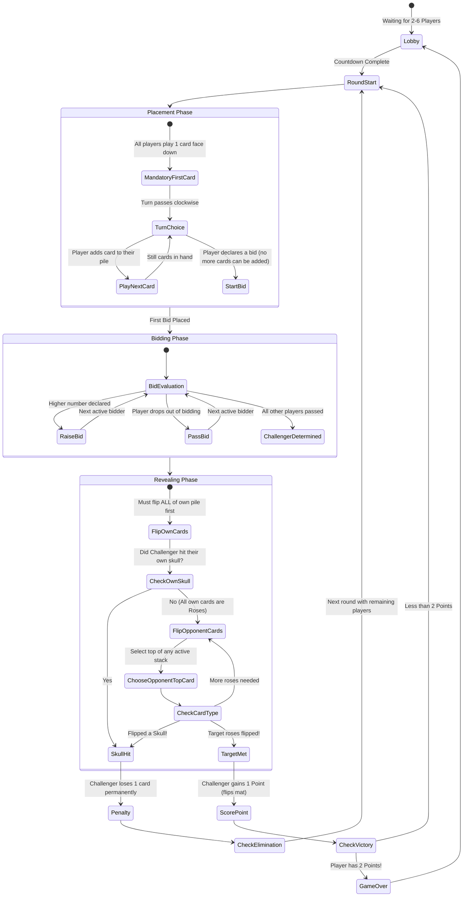
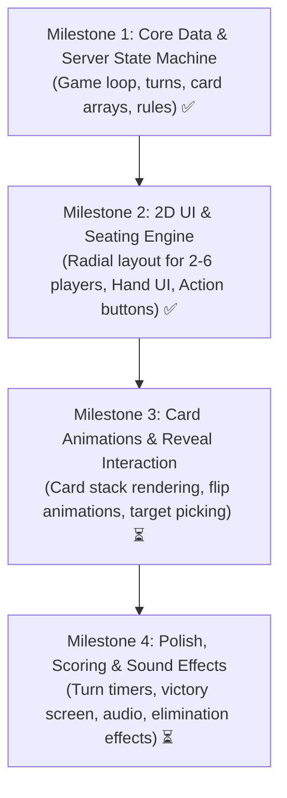

# Implementation Plan: Skull & Roses (Bluffing Game)

A multiplayer 2D/2.5D tabletop bluffing game for 2 to 6 players on Roblox, inspired by the classic card & coaster game *Skull & Roses* and styled with clean, responsive 2D interfaces (similar to modern Roblox card games like Uno).

---

## 1. Game Overview & Core Rules

Each player starts with **4 round cards** (3 **Roses**, 1 **Skull**) and a **Play Mat / Score Coaster**.

```
[Rose]  [Rose]  [Rose]  [Skull]
```

### Game Loop Flow



---

## 2. System Architecture & Project Structure

The project follows a **strict server-authoritative model** using Rojo and Luau to prevent exploiters from peeking at face-down cards.

### Directory Structure

```
F:\RobloxProject\
├── default.project.json
├── IMPLEMENTATION_PLAN.md          # This implementation plan
├── CODE_GUIDE.md                   # Plain-English file-by-file code reference
├── src/
│   ├── shared/
│   │   ├── Constants.luau          # Max/min players, timer lengths, card enums
│   │   ├── Enums.luau              # GameState, CardType, BidAction, PlayerState
│   │   └── Network.luau            # RemoteEvents & RemoteFunctions definitions
│   ├── server/
│   │   ├── init.server.luau        # Server entry point
│   │   ├── PlayerManager.luau      # Server-side player data (cards, scores, seats)
│   │   ├── BotController.luau      # AI bot decision engine
│   │   └── RoundManager.luau       # Placement, Bidding, Revealing logic
│   ├── client/
│   │   ├── init.client.luau        # Client bootstrapper
│   │   └── UI/
│   │       ├── Theme.luau          # Color palette & styling tokens
│   │       ├── NotificationBanner.luau # Announcements & 15s turn timer bar
│   │       ├── HandBar.luau        # Bottom 2D hand (3 Roses + 1 Skull)
│   │       ├── ActionBar.luau      # Contextual [Play Card], [Bid], [Pass]
│   │       └── TableView.luau      # Circular radial seat display (2-6 players)
```

---

## 3. 2D / Tabletop Visual Layout

Styled like modern digital tabletop games (UNO, Hearthstone, Exploding Kittens), combining a fixed overhead 2.5D camera with clean 2D screen UI.

```
+-------------------------------------------------------------------+
|  [Score: 1/2] Player 3               [Score: 0/2] Player 4        |
|     (Pile: 2 cards)                     (Pile: 3 cards)           |
|                                                                   |
|  [Score: 0/2] Player 2     [ CENTER TABLE ]     [Score: 0/2] P5   |
|     (Pile: 1 card)       Current Bid: 4 (P1)      (Pile: 2 cards) |
|                          Turn Timer: [== 12s ==]                  |
|                                                                   |
|  [Score: 0/2] Player 6               [Score: 1/2] (You - P1)      |
|     (Pile: 0 cards)                     (Your Pile: 2 cards)      |
+-------------------------------------------------------------------+
|  ACTIONS:  [ Place Card ]   [ Bid / Challenge (4+) ]   [ Pass ]   |
+-------------------------------------------------------------------+
|  YOUR HAND:                                                       |
|    [ (Rose) ]       [ (Rose) ]       [ (Rose) ]       [ (Skull) ] |
+-------------------------------------------------------------------+
```

### Key UI Components
1. **Player Seat Pods (2 to 6)**: Positioned radially around the center table. Displays:
   - Player Avatar / Name.
   - Stack of face-down card tokens (visually stacked height = number of cards played).
   - Score petals (2 slots, lighting up upon scoring).
   - Card count remaining in hand.
2. **Hand Display (Bottom)**: 
   - Draggable / clickable 2D cards with hover effects.
   - Grayed out when placing is no longer allowed (once bidding starts).
3. **Challenger Reveal Interaction**:
   - When revealing, opponent stacks highlight. The challenger clicks an opponent's stack to peel off the top card with a 3D/2D flip animation.

---

## 4. Security & Anti-Cheat (Crucial for Bluffing)

> [!IMPORTANT]
> Because Skull & Roses is 100% about bluffing and hidden information, **card types must NEVER be replicated to client machines** until they are revealed by the challenger.

* The server maintains `PlayerPiles[userId] = { CardType.Rose, CardType.Skull, CardType.Rose }`.
* The client only receives: `PlayerPileCounts[userId] = 3` and `HasPlayedCard = true`.
* When a card is flipped during the Reveal phase, the server broadcasts ONLY that single revealed card's type to all clients.

---

## 5. Required Assets & Styling

| Asset | Description | Format / Specs |
| :--- | :--- | :--- |
| **Rose Card Face** | Vibrant ornamental floral artwork (Day of the Dead / Calavera style). | 512x512 PNG, circular with transparent border |
| **Skull Card Face** | Stylized ornate skull with warning colors (gold/crimson/black). | 512x512 PNG, circular |
| **Card Back** | Symmetrical ornate pattern so orientation gives nothing away. | 512x512 PNG, circular |
| **Play Mat / Coaster**| Decorative radial coaster with 2 score gem slots. | 512x512 PNG |
| **Audio - Card Slide**| Crisp paper/cardboard placement sound. | Short SFX |
| **Audio - Card Flip** | Satisfying snap/flip sound. | Short SFX |
| **Audio - Skull Reveal**| Sudden dramatic gong/stinger. | Dramatic SFX |
| **Audio - Point Scored**| Celebratory chime. | Positive SFX |

---

## 6. Implementation Milestones



### Phase Breakdown
* **Phase 1: Foundation (Shared & Server State) — COMPLETED**
  - Define `Constants.luau`, `Enums.luau`, and `Network.luau`.
  - Build `PlayerManager.luau` and `RoundManager.luau` to handle turn order, bidding arithmetic, and card resolution.
* **Phase 2: Client Interface & Hand Controls — COMPLETED**
  - Implement dynamic radial seating (auto-arranging 2 to 6 players).
  - Implement bottom hand UI with card selection and play confirmation.
  - Implement bidding panel with dynamic min/max increments.
* **Phase 3: Reveal Sequence & Animations — IN PROGRESS**
  - Interactive stack clicking for the challenger.
  - Card flip animation with front/back sprite transition.
  - Card discard selection when a skull is hit.
* **Phase 4: Match Lifecycle & Polish**
  - Round transition overlays ("Player 1 Bid 3!", "Skull Hit!", "Round Won!").
  - Match end screen celebrating the 2-point winner.
  - SFX integration and visual polish.

